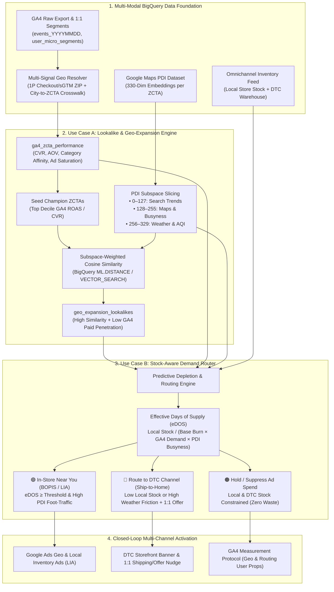

# Population Dynamics Insights (PDI) + GA4 + Stock Inventory Architecture Guide

## Executive Summary

By combining **Google Analytics 4 (GA4)** behavioral event streams with **Google Maps Population Dynamics Insights (PDI)** 330-dimensional geospatial embeddings and **Real-Time Retail & DTC Inventory**, marketing and commerce teams can move beyond reactive, geo-blind campaigns to an automated, closed-loop **Geo-Expansion & Stock-Aware Demand Routing Engine** in BigQuery.

---

## 1. Bridging GA4 Behavioral Data to PDI 5-Digit ZIP Codes (ZCTAs)

Standard GA4 BigQuery exports populate `geo.city`, `geo.metro`, and `geo.region`, while PDI embeddings are indexed by `geo_id` (5-digit ZCTA / Postal Code or S2 cell token) alongside Google Maps Place IDs (`administrative_area_level_1_id`, `administrative_area_level_2_id`).

We bridge GA4 and PDI using a **3-tier Multi-Signal ZIP Resolution waterfall** in BigQuery:
1. **Tier 1 — Direct Event Parameter (`event_params.zip_code`)**: Captured during store-locator searches, shipping calculator checks, or Server-Side GTM (sGTM) IP-to-Postal-Code enrichment.
2. **Tier 2 — User Property (`user_properties.postal_code`)**: Persisted from 1st-party authenticated profiles or historical `purchase` / `begin_checkout` addresses.
3. **Tier 3 — Probabilistic City-to-ZCTA Crosswalk (`city_to_zcta_crosswalk`)**: For anonymous top-of-funnel browsers where only `geo.city` and `geo.region` are known, interactions are mapped to constituent ZCTAs weighted by commercial population share and deterministic user-hash bucketing (`MOD(ABS(FARM_FINGERPRINT(user_pseudo_id)), 100)`).

---

## 2. Use Case A: Lookalike / Geo-Expansion via Subspace-Weighted PDI Embeddings

### How PDI's 330 Dimensions Power Geo-Expansion
Each ZCTA row in the PDI BigQuery table contains `features: ARRAY<FLOAT64>` of length 330, structured into three distinct latent domains:

| Embedding Indices | Domain Subspace | What It Captures | Marketing Role in Use Case A |
| :--- | :--- | :--- | :--- |
| **`0 – 127`** (128 dims) | **Search Trends** | Regional search intent, product category interest, lifestyle & topic affinities | Finds ZIPs exhibiting the same latent product research & category curiosity as top-converting GA4 markets. |
| **`128 – 255`** (128 dims) | **Maps & Busyness** | Built environment, retail POI density, commercial foot traffic, daytime vs. residential dynamics | Matches urban/suburban retail structure, affluent shopping corridors, and physical commerce density. |
| **`256 – 329`** (74 dims) | **Weather & Air Quality** | Temperature, precipitation, seasonality, AQI, wind patterns | Aligns climate-sensitive product demand (e.g., Smart Home thermostats, seasonal apparel, outdoor wearables). |

### Subspace-Weighted Cosine Similarity & White-Space Scoring
Instead of treating all 330 dimensions equally, we slice `features` into three sub-vectors ($\mathbf{v}_{\text{search}}, \mathbf{v}_{\text{maps}}, \mathbf{v}_{\text{weather}}$) and compute a **Subspace-Weighted Cosine Similarity** $S(z, C)$ between any candidate ZCTA $z$ and the GA4 Seed Champion Centroid $C$:

$$S(z, C) = \frac{w_s \cdot \left(1 - D_{\cos}(\mathbf{v}_{\text{search}}^{(z)}, \mathbf{c}_{\text{search}})\right) + w_m \cdot \left(1 - D_{\cos}(\mathbf{v}_{\text{maps}}^{(z)}, \mathbf{c}_{\text{maps}})\right) + w_w \cdot \left(1 - D_{\cos}(\mathbf{v}_{\text{weather}}^{(z)}, \mathbf{c}_{\text{weather}})\right)}{w_s + w_m + w_w}$$

where $D_{\cos}(\mathbf{a}, \mathbf{b}) = \text{ML.DISTANCE}(\mathbf{a}, \mathbf{b}, \text{'COSINE'})$ in BigQuery.

To ensure we target **untapped high-potential areas** rather than saturating already-penetrated markets, we compute the **White-Space Geo-Expansion Score** $W(z)$:

$$W(z) = S(z, C) \times \left(1 - \text{PenetrationIndex}(z)\right)^{\gamma} \times \text{CategoryAffinityMultiplier}(z)$$

---

## 3. Use Case B: Stock-Aware Demand Routing (PDI + GA4 + Inventory)

### Why Static Stock Thresholds Fail Without PDI & GA4
A traditional rule like *"If store stock > 10 units, run In-Store ads"* fails in two common scenarios:
1. **Imminent Stockout Trap**: A store has 18 units on the shelf, but **GA4** shows a local online `view_item`/`add_to_cart` spike AND **PDI Maps Busyness (`128–255`)** indicates weekend foot-traffic is surging $1.8\times$. Those 18 units will sell out organically in 1.2 days—running "In-Store Near You" ads wastes budget and frustrates shoppers who arrive to empty shelves.
2. **Low Foot-Traffic / Weather Friction Trap**: A store has 40 units in stock, but **PDI Weather (`256–329`)** indicates severe weather/poor AQI or **PDI Maps (`128–255`)** shows the user's ZIP is a commuter-desert with low retail transit propensity. Forcing an "In-Store Only" CTA suppresses conversion compared to routing the user to **DTC Express Delivery**.

### Mathematical Formulation: Effective Days of Supply ($\text{eDOS}$)
For every ZCTA $z$ and SKU $k$ mapped to nearest physical store $s$:

$$\text{Predicted Daily Burn}_{z,k} = \text{BaseStoreBurn}_{s,k} \times \left(1 + \alpha \cdot \text{GA4DemandIndex}_{z,k}\right) \times \left(1 + \beta \cdot \text{PDIMapsBusyness}_{z}\right) \times \left(1 - \delta \cdot \text{PDIWeatherFriction}_{z}\right)$$

$$\text{eDOS}_{z,k} = \frac{\text{StoreOnHandUnits}_{s,k}}{\max(0.5, \; \text{Predicted Daily Burn}_{z,k})}$$

### 3-Way Omnichannel Routing Matrix

| Routing Decision | Trigger Condition | Ad Campaign & Bid Action | On-Site / 1:1 Storefront Experience |
| :--- | :--- | :--- | :--- |
| 🟢 **`IN_STORE_BOPIS_LIA`** | $\text{eDOS}_{z,k} \ge \tau_{\text{dos}}$ **AND** $\text{InStorePropensity}_{z} \ge \tau_{\text{foot}}$ **AND** Store Distance $\le 15\text{ mi}$ | Trigger **Google Ads Local Inventory Ads (LIA)** & "In-Store Near You" radius bid boost ($+25\%$ to $+45\%$). | Hero Banner: *"In Stock Near You at [Store Name] — Ready for 1-Hour Pickup!"* |
| 🔵 **`DTC_WAREHOUSE_SHIP`** | ($\text{eDOS}_{z,k} < \tau_{\text{dos}}$ **OR** No nearby store **OR** High Weather Friction) **AND** $\text{DTCWarehouseUnits}_{k} > \tau_{\text{dtc}}$ | Suppress Local Store extensions; route ad clicks to **DTC Ship-to-Home Shopping/PMax** campaign. | Hero Banner: *"Fast DTC Warehouse Fulfillment — Free 2-Day Delivery + 1:1 GA4 Offer!"* |
| 🟠 **`SUPPRESS_HOLD_SPEND`** | $\text{eDOS}_{z,k} < \tau_{\text{dos}}$ **AND** $\text{DTCWarehouseUnits}_{k} \le \tau_{\text{dtc}}$ | **Pause paid SKU retargeting & geo-expansion bids** in ZIP $z$ to protect ROAS. | Hero Banner: *"Notify Me When Back in Stock + Browse Similar In-Stock Favorites"* |
